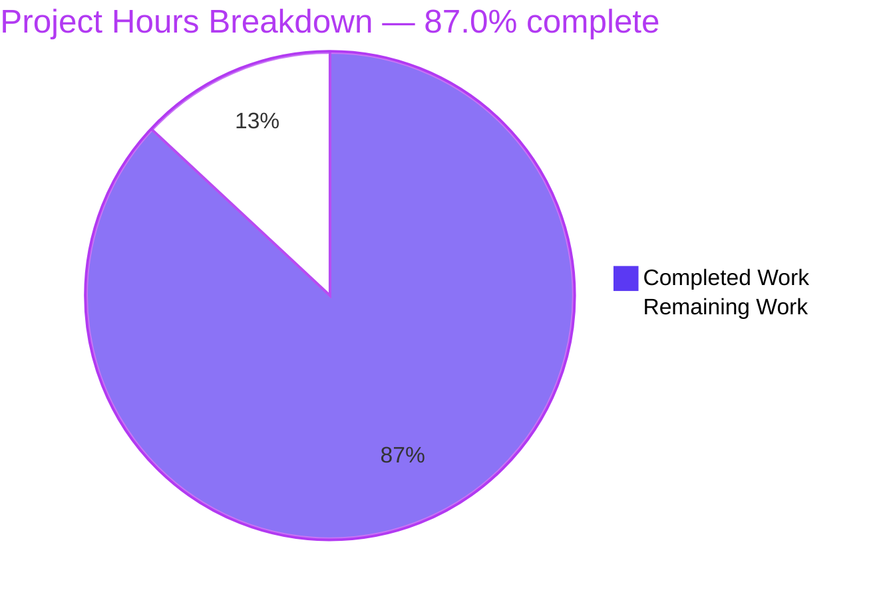
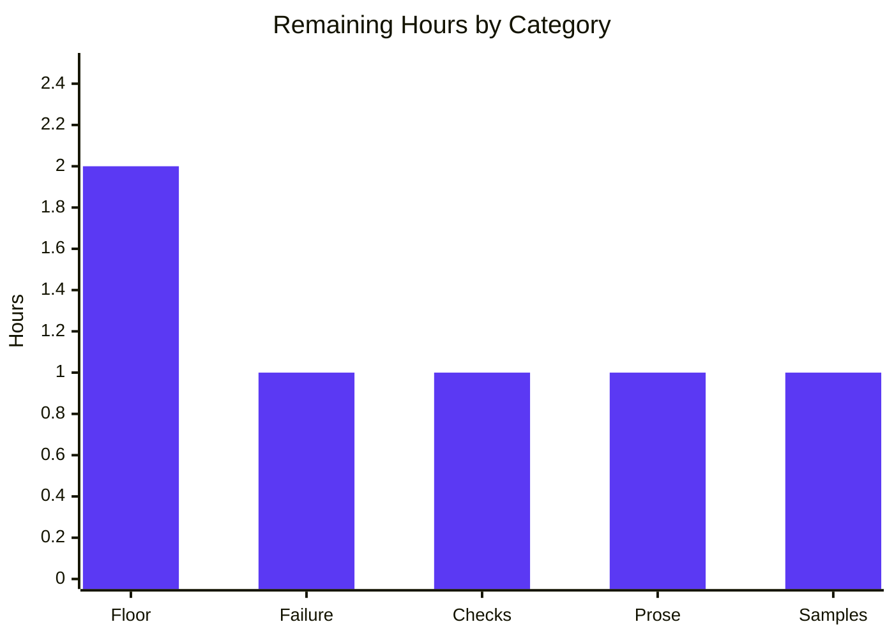

# 1. Executive Summary

A single-file, zero-dependency Node.js HTTP server built as a teaching reference for the built-in `http` module. It serves `GET /hello` with `200`, `text/plain` and `Hello world`; answers every other method-and-path combination with `404`, `text/plain`, `Not Found`; logs one line per request; takes its port from `PORT` (default `3000`, range `1024`–`65535`); reports configuration and bind failures actionably with a non-zero exit; and stops cleanly on `CTRL+C` with status `0`. Readers are beginner Node.js developers and instructors. Scope is exactly `server.js`, `package.json` and `README.md`.

## 1.1 Project Overview

The product, its users and its boundaries:

| Dimension | What it is |
| --- | --- |
| Deliverable | `server.js` (the whole application), `package.json` (identity, start script, runtime floor), `README.md` (ten-section guide) |
| Primary users | Beginner Node.js developers learning the `http` module; instructors reproducing the example |
| Business value | One readable file that demonstrates server creation, per-request routing, response writing, request logging, configuration validation and clean shutdown |
| Technical scope | One process, one listening socket, one route table with a single entry, two fixed response contracts, three console line kinds, one environment variable |
| Explicitly not included | Frameworks, routing/middleware libraries, persistence, authentication, TLS, static assets, tests, CI, containers, deployment automation |

## 1.2 Completion Status



| Metric | Hours |
| --- | --- |
| Total Hours | 46 |
| Completed Hours (AI + Manual) | 40 |
| Remaining Hours | 6 |

Completion is hours-based and scoped to the agreed work: **40 ÷ (40 + 6) × 100 = 87.0%**. The build is functionally complete; the 6 remaining hours are documentation completeness and two verifications that have not yet been taken.

## 1.3 Key Accomplishments

- `GET /hello` answers `200`, `text/plain`, `Content-Length: 11`, body `Hello world`.
- Every other method-and-path pair answers `404` with `Not Found`; `POST /hello` and `HEAD /hello` are misses, not matches.
- One `<ISO-8601 Z> <METHOD> <path>` log line per request, emitted before routing decides anything.
- `PORT` read once: default `3000`, empty treated as unset, `1024`–`65535` accepted.
- Invalid and privileged ports refused with actionable stderr text and exit 1; a port in use reported with the remedy, leaving the incumbent serving.
- `CTRL+C` prints `Server shutting down`, releases connections and exits 0, even with an idle keep-alive connection held.
- Zero third-party dependencies: one built-in require; `npm start` runs with nothing installed.
- No dynamic evaluation, file-system access, outbound request, persistence or internal detail in responses.

## 1.4 Critical Unresolved Issues

**2 of the 15 in-scope items carry something still open** — both are verification and documentation completeness, and neither blocks release.

| Issue | Impact | Owner | ETA |
| --- | --- | --- | --- |
| Acceptance verification: the declared runtime floor (Node 18.0.0) has never been executed — every run was on a newer line — and the generic `Cannot start server: <error.message>` listen-error branch has no natural runtime trigger (1 of 15 items) | The floor and that branch rest on static reasoning plus behaviour observed on a newer runtime, not on an observation of their own | Development | 3h |
| Documentation completeness: the three supporting checks (`node --check server.js`, the placeholder grep, the zero-dependency greps) are not documented, two attribution clauses beside quoted transcripts are incomplete, and the quoted latency and memory samples want refreshing on a quiet host (1 of 15 items) | A reader cannot reproduce those three checks from the document, must read two paragraphs together for the complete header attribution, and sees samples taken on a busy host | Development | 3h |

## 1.5 Access Issues

No access issues identified. The project needs no credential, service, database, registry account or network access.

## 1.6 Recommended Next Steps

1. **[High]** Record the deployment context: the listener binds every interface, with no authentication, TLS or rate limiting by design.
2. **[Medium]** Execute the declared Node 18.0.0 floor line and re-run the acceptance checks on it.
3. **[Medium]** Exercise the generic listen-error path and record its message and exit status.
4. **[Low]** Document the three supporting checks and close the two attribution clauses in the README.
5. **[Low]** Refresh the README's quoted latency and memory samples on an idle host.

# 2. Project Hours Breakdown

## 2.1 Completed Work Detail

| Component | Hours | Description |
| --- | --- | --- |
| Application core | 8 | `server.js`: the frozen route table with its single `GET /hello` entry, both handlers, the single response writer that sets status, `Content-Type` and one `end()` call, request logging, and the path derivation that strips a query string and leaves percent-encoding undecoded |
| Configuration and failure paths | 5 | Port resolution and validation in `resolvePortFromEnv`: default `3000`, empty/whitespace treated as unset, trimming, the `1024`–`65535` range, the four anchored refusal messages derived from `MIN_PORT`/`MAX_PORT`, the startup error listener, and exit status 1 on every fatal path |
| Process lifecycle | 3 | The `SIGINT` handler: the `Server shutting down` line, `server.close()`, the tracked-socket teardown that makes the exit deterministic at the declared runtime floor, and exit status 0 |
| Package manifest | 1 | `package.json` with exactly the seven agreed fields at their agreed values, the `npm start` wiring and the advisory `engines.node` floor; no dependency section |
| Documentation | 8 | `README.md`'s ten sections in reading order: purpose, prerequisites, installation, running, configuration, testing, expected output, request logging, stopping, project structure and latency check — every command complete with the output it produces, and every quoted message byte-identical to what the code emits |
| Acceptance verification on the running application | 12 | The full gate set exercised against live instances: both response contracts, method and path matrices, query-string and percent-encoding behaviour, request-log shape and order, port override, empty-value fallback, accepted bounds, refused values, duplicate bind, shutdown status, `npm start`, manifest reads, the static and boundary greps, the latency series, the 50-way concurrency burst, the memory samples, hostile-payload and raw-socket probes, and the browser-rendered checks of both bodies |
| Integration and whole-package re-verification | 3 | Build check, seams checks across the three deliverables, integration smoke tests through the running application, and the regression sweep re-run after the later documentation changes |
| **Total** | **40** | Equals the Completed Hours in Section 1.2 |

## 2.2 Remaining Work Detail

| Category | Hours | Priority |
| --- | --- | --- |
| Runtime floor verification — execute the declared Node 18.0.0 line and re-run the acceptance gate set on it, recording the startup line, both contracts, the port-gate messages and the shutdown status | 2.0 | Medium |
| Failure-path verification — exercise the generic `Cannot start server: <error.message>` branch under controlled conditions and record the message and exit status | 1.0 | Medium |
| Documentation — add the three supporting checks (`node --check server.js`, the placeholder grep, the zero-dependency greps) so the acceptance evidence is reproducible from the document | 1.0 | Low |
| Documentation — name the Node.js runtime as the source of `Content-Length` beside the quoted transcript, and add a stop-first note before the self-contained commands | 1.0 | Low |
| Measurement refresh — re-take the README's quoted latency and resident-set samples on an idle host and update the figures if they differ materially | 1.0 | Low |
| **Total** | **6.0** | Equals the Remaining Hours in Section 1.2 and the `Remaining Work` value in Section 7 |

# 3. Test Results

The project ships no automated test suite: the agreed deliverable is exactly three files and the acceptance evidence is a command set, which is what was executed here against live instances of the finished server on Node v22.23.3. **87 checks executed — 83 terminal command checks and 4 browser assertions — 87 passed, 0 failed.** Coverage is not instrumented anywhere, because no coverage tooling exists in the project.

| Area / Category | Framework | Tests | Passed | Failed | Coverage | What This Proves |
| --- | --- | --- | --- | --- | --- | --- |
| HTTP response contracts | Command gates (`curl`) | 12 | 12 | 0 | Not instrumented | `GET /hello` answers 200 with `text/plain`, `Content-Length: 11` and body `Hello world`; `/invalid`, `POST /hello` and `HEAD /hello` answer 404 with `Content-Length: 9` and `Not Found`; a query string still matches and a percent-encoded path does not; no response is chunk-framed |
| Request logging | Command gates (`curl`, log inspection) | 3 | 3 | 0 | Not instrumented | Every request — matched or not — produces exactly one `<ISO-8601 Z> <METHOD> <path>` line, in arrival order, on stdout only |
| Port configuration and validation | Command gates (`node`) | 34 | 34 | 0 | Not instrumented | Default `3000`, empty and whitespace-only treated as unset, surrounding whitespace trimmed, `1024` and `65535` accepted, and 11 invalid shapes each refused with the anchored message, nothing bound and exit 1 |
| Bind failure and lifecycle | Command gates (`node`, `curl`, `kill -INT`) | 13 | 13 | 0 | Not instrumented | The startup line appears only after a successful bind with stderr empty; a port already in use is reported with the exact remedy and exit 1 while the incumbent keeps serving; `CTRL+C` prints `Server shutting down`, releases connections, exits 0 and frees the port |
| Entry points and manifest | Command gates (`npm`, `node -e`) | 5 | 5 | 0 | Not instrumented | `npm start` and `node server.js` are equivalent with nothing installed, and the manifest carries exactly `name,version,description,main,scripts,engines,keywords` with the agreed values and no dependency section |
| Performance and memory obligations | Command gates (`curl`, `seq`/`xargs`, `ps`) | 4 | 4 | 0 | Not instrumented | 20 latency samples, worst 0.000831 s; a 50-way concurrent burst returns 550 bytes of bodies with a still-answering server; resident set stays level across 2 000 requests |
| Static integrity and closed boundaries | Command gates (`node --check`, greps) | 12 | 12 | 0 | Not instrumented | The file parses, requires only `node:http`, contains no evaluation, file-system, outbound-network or persistence capability, no regular expression, no placeholder token, and the tracked set is exactly the three deliverables |
| Browser-rendered surface | Chrome session | 4 | 4 | 0 | Not instrumented | Both contracts render as plain text in a real browser with the contracted statuses and header sets, no `Transfer-Encoding`, and no application console error |

**Not Covered** — what no test or runtime check exercises:

- **Automated regression detection.** Nothing in the repository re-runs any of the above; a future edit to `server.js` is covered only by re-running the documented commands by hand.
- **The declared runtime floor.** Every run was on Node v22.23.3. The file uses no API newer than 18.0.0, but the Node 18.0.0 line itself was never executed, so the floor is inferred from the API surface rather than observed.
- **The generic listen-error path.** Only the port-already-in-use case has a natural trigger; the `Cannot start server: <error.message>` branch needs an induced condition and has never been observed on its own.
- **Protocol and framing edges outside the contract.** HTTP/1.0 responses, `HEAD` without `Content-Length`, parser-level `400`/`431` answers for malformed requests, and half-open connections held to the runtime's header timeout were observed ad hoc during probing but no repeatable check asserts them.
- **Sustained load and abuse.** The concurrency, memory and payload measurements are bounded probes; no soak test, no long-running soak, and no rate-limiting behaviour exists to test.

# 4. Runtime Validation & UI Verification

The server was started as a real process and driven over real TCP sockets with `curl`, raw sockets and a headless Chrome session. Its only user-facing surfaces are two `text/plain` bodies and three console line kinds; there is no HTML, no client-side code and no external service to integrate with.

- ✅ **Start-up** — `node server.js` and `npm start` each print `Server listening on port <port>` from the listen callback with zero bytes on stderr, and only after the socket is bound.
- ✅ **`GET /hello`** — HTTP/1.1 200 OK, `Content-Type: text/plain`, `Content-Length: 11`, body `Hello world`, no `Transfer-Encoding`, over both `curl` and a browser navigation.
- ✅ **Catch-all route** — 404 `Not Found` with `Content-Length: 9` for an unmatched path, an unmatched method (`POST /hello`, `HEAD /hello`), a percent-encoded path and a browser's `/favicon.ico` probe; `/hello?x=1` still matches `/hello`.
- ✅ **Request logging** — one conforming `<ISO-8601 Z> <METHOD> <path>` line per request, in arrival order, before the routing decision, with nothing written to stderr.
- ✅ **Port configuration** — default `3000`, empty and whitespace-only treated as unset, surrounding whitespace trimmed, an override serving on its own port with the default left unbound, both accepted bounds (`1024`, `65535`) serving, and 11 refused shapes each exiting 1 with the anchored message and nothing bound.
- ✅ **Bind failure** — a second instance on a held port reports the exact remedy text and exits 1 while the first instance keeps answering.
- ✅ **Shutdown** — `CTRL+C`/`kill -INT` prints `Server shutting down`, releases the connections it holds, exits 0 and leaves the port free, including with an idle keep-alive connection held open.
- ✅ **Performance and memory** — 20 latency samples all under 10 ms (worst 0.000831 s), a 50-way concurrent burst answered in full with a responsive follow-up, and a level resident set across 2 000 requests.
- ✅ **Browser surface** — both bodies render correctly as plain text, the wire carries the contracted statuses and header sets with no chunked framing, and the only console entry is Chrome's own report of the contracted 404 statuses, not an application error.
- ⚠ **Never exercised at runtime** — the declared Node 18.0.0 floor line itself (all runs were on Node v22.23.3), and the generic `Cannot start server: <error.message>` listen-error branch, which has no natural trigger.

No integration was left undriven: the product has no outbound client, no database, no queue and no third-party service, so the runtime surface is the two routes, the three console lines and the process lifecycle, all of which were exercised.

# 5. Compliance & Quality Review

## 5.1 Compliance Matrix

| Deliverable / Requirement Area | Benchmark | Verified Status | Progress |
| --- | --- | --- | --- |
| Both response contracts — `GET /hello` 200 `Hello world`; every other method-and-path pair 404 `Not Found` | Contract fidelity; exact-match routing with an explicit fallback | Verified against live instances and a browser: status, `Content-Type`, `Content-Length` and body byte-exact, method part of the match | ✅ Complete |
| Request observability — one log line per request before routing, plus the startup and shutdown lines | Fixed output shapes; diagnostics on stderr only | Verified: 100% of logged requests conformed to `<ISO-8601 Z> <METHOD> <path>` in arrival order, stderr empty on every successful run | ✅ Complete |
| Configuration surface — `PORT` read once, default `3000`, empty treated as unset, trimming, `1024`–`65535` | Documented behaviour matchable by a reader | Verified for the default, the empty and whitespace-only fallback, trimming, an override, both bounds and 11 refused shapes | ✅ Complete |
| Failure handling — actionable message, nothing bound, exit 1 for invalid configuration and for a port in use | Actionable errors; graceful failure; no raw runtime dump | Verified: anchored stderr text, empty stdout, exit 1, incumbent instance unaffected | ✅ Complete |
| Lifecycle — `CTRL+C` logs, releases connections and exits 0 | Deterministic clean shutdown at the declared runtime floor | Verified with an idle keep-alive connection held open; exit status 0 and the port released | ✅ Complete |
| Manifest — seven agreed fields, exact values, no dependency section | Metadata fidelity; package-manager semantics | Verified by reading the key list and each value; `npm ls --all` reports an empty tree | ✅ Complete |
| Zero dependencies — one built-in require, nothing to install | Minimalism mandate; checkable by inspection | Verified: `require('node:http')` is the only one, and the server runs on a host where nothing was ever installed | ✅ Complete |
| Security boundaries — no evaluation, file-system access, outbound request or persistence; no internal detail in responses | Structural rather than defensive controls | Verified by inspection, by greps, by hostile-payload and raw-socket probes, and by reading both response bodies | ✅ Complete |
| Performance obligations — sub-10 ms `/hello`, unblocked concurrency, stable memory | Measured obligations, not assertions | Verified: worst latency 0.000831 s, 50/50 concurrent bodies, resident set level across 2 000 requests | ✅ Complete |
| Code quality — purpose-revealing names, one responsibility per function, reasoning-only comments, no dead code | Readability as the product's purpose | Verified: nine single-purpose functions, six comment blocks each carrying a decision the code cannot | ✅ Complete |
| Documentation — ten sections, every command with the output it produces, quoted messages matching the code | Zero-knowledge readability | Verified section by section; the three supporting checks and two attribution clauses remain (2h, Section 2.2) | ✅ Complete, with a 2h follow-up |
| Completeness — exactly the three agreed files, no placeholder, unreachable branch or unnamed artefact | Exhaustive deliverable set; no provisional content | Verified: the delivered tree holds exactly three tracked paths and no path beyond them was ever added; placeholder sweep empty; no test, CI, container, lockfile or configuration artefact | ✅ Complete |

## 5.2 AAP & Rule Divergences and Gaps

| # | What the AAP/Rule Required | What Was Delivered Instead | Why It Diverged | Impact | Remediation |
| --- | --- | --- | --- | --- | --- |
| 1 | The agreed concurrency check's counting command, `seq 1 50 \| xargs -P 50 -I{} curl -s …/hello \| grep -c '^Hello world$'`, expected to print `50` | `README.md:444` documents `… \| grep -o 'Hello world' \| wc -l`, and the runs verified concurrency by total byte count (550) and occurrence count | The fixed body has no trailing newline, so fifty concurrent bodies concatenate into one line and an anchored whole-line count can never print 50 for any correct implementation | None for the product; the documented command prints the expected `50`, while the agreed text would mislead anyone re-running it | None required. Align any internal acceptance checklist with the documented form when convenient |
| 2 | `README.md` listed as a file to create, alongside `server.js` and `package.json` | Delivered as an in-place update over the repository's pre-existing two-line scaffold (`M README.md`, +478/−2) | The repository already carried a scaffold at that path, so its content was replaced rather than a new file created | None: the delivered document is complete and the scaffold's residue is gone | None |
| 3 | Four ordered shutdown steps, read as a sequence: log, `server.close(callback)`, release tracked sockets, exit 0 from the callback | `server.js:106-116` destroys the tracked sockets immediately after calling `server.close(callback)`, before that callback runs | Releasing the sockets only from the callback could never release an idle keep-alive connection, so `CTRL+C` could hang instead of exiting 0 — the exit-status requirement outranks the step ordering | Connections are closed abruptly at shutdown instead of being drained; the exit is deterministic (status 0 in single-digit milliseconds, even with an idle connection held) | None. If connection draining is ever promised, the shutdown path and the README must change together |
| 4 | The accepted port range and the privileged-port refusal documented in the README, with the three supporting checks (`node --check server.js`, the placeholder grep, the zero-dependency greps) part of the acceptance evidence | The range and refusal are documented; the three supporting checks are not named anywhere in `README.md`, though all three were executed and pass | The README's agreed content table fixes ten sections and names none of the three, so the document was kept to that content | Low: a reader cannot reproduce those three checks from the document, although nothing about the shipped behaviour depends on them | Add a short verification block to `README.md` (1h, Section 2.2) |
| 5 | Quoted transcripts paired with complete prose about where each response header comes from | `README.md:153-154` quotes the application-set headers without naming the runtime as the source of `Content-Length`, and `README.md:152` names the `-S` flag without quoting that variant's line | The transcript is fixed by the agreement; the prose asserts nothing false, and quoting the `-S` variant's version- and port-dependent line would be brittle | Negligible: a reader must read two paragraphs together to get the complete header attribution | One clause each while editing the README for divergence 4 (covered by the same 1h task) |

No user-specified rules accompany this project, so nothing in the delivery departs from a user rule. The five divergences above are departures from the agreed plan, not from user instructions.

**Divergence 1 — the concurrency counter.** The agreed command counts anchored whole lines, but the contracted body is exactly `Hello world` with no trailing newline — `Content-Length: 11` is fixed and quoted in the README, and a newline would make it 12. Fifty concurrent bodies arrive concatenated as one line, so `grep -c '^Hello world$'` returns `0` however correct the server is. Rather than publish a command that cannot succeed, `README.md:444` documents the faithful equivalent, `grep -o 'Hello world' | wc -l`, which prints `50` here; the property — fifty concurrent requests, none refused, each with the right body, and a responsive follow-up — was measured by total bytes (550 = 50 × 11), occurrence count and per-response capture.

**Divergence 2 — the README was updated in place, not created.** The plan describes all three deliverables as new files, which was true of `server.js` and `package.json`. The repository already carried a two-line placeholder `README.md` from its initial commit, so the delivered document replaced that content rather than creating a new path: the history shows `M README.md` (+478/−2) where the plan expected a creation. Nothing in the document depends on the scaffold and no section references it. Reviewing the branch, you will see the file as modified rather than added; no action follows, and any later diff against the base commit will include the two deleted lines.

**Divergence 3 — the shutdown step order.** The plan describes four shutdown steps as a sequence — log, close the server, release the tracked sockets, exit from the close callback. `server.js:106-116` performs the third step immediately after calling `server.close(...)` rather than inside its callback, because `close()` completes only once every existing connection has ended: waiting for the callback to release the sockets would let an idle keep-alive connection hold the process open, so `CTRL+C` could hang instead of exiting `0`. The ordering that ships is what makes the exit deterministic at the declared runtime floor, where the runtime's own helpers for closing idle connections do not exist. Connections therefore close abruptly at shutdown rather than being drained.

**Divergence 4 — the supporting checks are not documented.** Three checks that form part of the acceptance evidence — `node --check server.js`, the negative placeholder grep, and the zero-dependency greps (the single `require`, plus the absence of evaluation, file-system and outbound-network calls) — are not mentioned in `README.md`. They were executed against the delivered artefacts and all pass; they are absent because the README's agreed content table fixes ten sections and names none of them, so the document was held to that list. The cost falls on a reader reproducing the full evidence set from the document alone: they will find commands for both contracts, the port behaviour and the performance spot-checks, but not these three.

**Divergence 5 — two attribution clauses.** Two prose points beside quoted transcripts are incomplete rather than wrong. `README.md:153-154` quotes the headers the application sets and names the runtime as the source of `Date`, `Connection` and `Keep-Alive`, but does not say that `Content-Length` is also computed by the runtime even though the quoted block shows it; the Testing section states this correctly a page later. Separately, `README.md:152` tells the reader to add `-S` to see curl's connection-failure line without quoting that line, deliberately: its literal text varies with curl version and port and would go stale. Both close with one clause each.

# 6. Risk Assessment

Risks below are forward-looking: what could still go wrong once this code is used or extended. Every one of them is a property of the agreed scope or of the runtime the application sits on, not an open defect.

| Risk | Category | Severity | Probability | Mitigation | Status |
| --- | --- | --- | --- | --- | --- |
| No automated regression detection: the deliverable is three files with no suite, so an edit to `server.js` is checked only by re-running the documented commands by hand | Technical | Medium | High | Use the documented acceptance commands as a change checklist; keep the two contracts and the port-gate messages as the pass criteria | Accepted, inherent to the agreed scope |
| The declared runtime floor (`engines.node: ">=18.0.0"`) is past end-of-life, and the floor line has never been executed here | Operational | Medium | High | Run the file once on the oldest line you intend to support before advertising it; raise the declared floor when the tutorial is next revised | Open — 2h verification task in Section 2.2 |
| No authentication, TLS, rate limiting or security headers, and the listener binds every interface | Security | Medium | Medium | Run it for its intended teaching purpose on a local or trusted network, or place it behind infrastructure that supplies those layers | Accepted by design; a deployment decision, not a code gap |
| Working-set growth under large request bodies: repeated multi-megabyte uploads that are never read push resident memory from roughly 60 MB to roughly 80 MB and the runtime does not return those pages to the OS | Technical | Low | Medium | Bounded and self-limiting (flat across consecutive large requests); if uploads are expected, terminate them at a proxy rather than adding body handling the contract forbids | Accepted; measured and bounded |
| Console output integrity: the request log carries the full path, so a client can drive up to about 16 KB of stdout per request, and an operator-supplied `PORT` value is echoed to stderr verbatim | Operational | Low | Medium | Treat stdout and stderr as untrusted text in any downstream parsing; the parser's header limit bounds the per-line cost | Accepted; format is contracted |
| Unbounded connection tracking: the tracked socket set grows with concurrently open connections, with no connection or timeout limits configured | Technical | Low | Low | Sound at the declared scale (single host, tens of connections); the runtime's own idle timeout and the host's descriptor limit are the practical bounds | Accepted; scale is out of the agreed scope |
| Transport-layer behaviour belongs to the runtime: unknown method tokens and malformed request lines are answered `400`/`431` before the application sees them and produce no log line, half-open connections are held to the runtime's own header timeout, and `HEAD` or HTTP/1.0 responses carry no `Content-Length` | Integration | Low | Medium | Know the boundary when writing a client: only requests the runtime accepts reach the catch-all; do not read the request log as a complete access record | Accepted; runtime-provided HTTP |
| Port contention with the documented literals: the README's self-contained commands each start their own server on port `3000`, so a reader whose own server is already running meets the in-use message instead of the quoted transcript | Integration | Low | Medium | Documented remedy is the `PORT` override; one sentence telling the reader to stop the running server first removes the inference | Open — covered by the 1h documentation task in Section 2.2 |

# 7. Visual Project Status

Project hours, split between the work that is complete and the work that remains:


Remaining hours by category, as listed in Section 2.2:



| Remaining Category (Section 2.2) | Hours | Priority |
| --- | --- | --- |
| Runtime floor verification | 2.0 | Medium |
| Failure-path verification | 1.0 | Medium |
| Supporting checks documented | 1.0 | Low |
| Attribution prose and stop-first note | 1.0 | Low |
| Measurement refresh | 1.0 | Low |
| **Total Remaining** | **6.0** | — |

**Completed Work = 40 hours** and **Remaining Work = 6 hours**, matching the metrics table in Section 1.2 and the totals in Sections 2.1 and 2.2. The completion figure these charts display is **87.0%** — 40 ÷ 46 × 100.

# 8. Summary & Recommendations

**What was delivered and verified.** A complete, runnable teaching server in three files: `server.js` with the frozen route table, both handlers, a single response writer, request logging, port resolution and validation, the two fatal failure paths and a deterministic `CTRL+C` shutdown; `package.json` with exactly the seven agreed fields and no dependency section; and a ten-section `README.md` whose every command is paired with the output it produces. Everything the project promises was exercised on live instances: both contracts byte-exact over `curl` and in a browser, log lines conforming one per request in arrival order, the default and empty-valued port behaviour, both accepted bounds, eleven refused shapes, the port-in-use report, the clean exit status, sub-10 ms latency, a fifty-way concurrent burst, a level resident set across two thousand requests, and the static and boundary checks that prove the file evaluates nothing, touches no file system, makes no outbound request and stores nothing. **87 checks executed, none failed.**

**Where the project stands.** The agreed work is **87.0% complete** — 40 of 46 hours delivered, 6 remaining. All 36 scoped requirements are met as written, with two of them carrying verification that has not yet been taken, and the twelve compliance areas in Section 5.1 pass, one of them with a small documentation follow-up. The remaining hours are not missing functionality: 3 of the 6 are verification (executing the declared Node 18.0.0 floor line and exercising the generic listen-error branch, which has no natural trigger) and 3 are documentation completeness and a measurement refresh. Nothing on the list changes behaviour; all of it changes what a reader or reviewer can see for themselves.

**The critical path to production.** The code is ready to run as it stands — start it with `node server.js` or `npm start` on any Node 18-or-newer host and both contracts answer immediately, with nothing to install and nothing to configure beyond `PORT`. Before publishing or teaching from it, close the remaining items in this order: confirm the floor line you intend to advertise actually runs the file (2h), exercise the generic listen-error branch (1h), add the three supporting checks and the two attribution clauses to the README (2h), and refresh the quoted latency and memory samples on an idle host (1h). None of these blocks a reader from using the server today.

**Accepted by design, and worth deciding deliberately.** Five properties are absences the agreed scope specifies rather than gaps: no automated test suite (so a future edit is covered only by re-running the documented commands), no authentication, TLS, rate limiting or security headers (with the listener bound to every interface), no persistence or static files, no CI, container or deployment automation, and no connection or timeout tuning. Each was verified as a deliberate condition of the three-file deliverable. If this tutorial is ever placed somewhere other than a local or trusted network, the security set is the first thing to add — and the first four are exactly the layers a real service would need around it.

**Success metrics.** Both response contracts answer byte-exactly with determinate framing (no chunked encoding) over `curl` and in a browser; one conforming log line per request with an empty stderr; the port gate accepts 1024–65535, defaults to 3000 for an unset or empty value, and refuses eleven invalid shapes with actionable text and exit 1; a port already in use is reported without disturbing the incumbent; `CTRL+C` exits 0 with the port released; latency stays under 10 ms and memory levels off after warm-up; and the tracked deliverable set is exactly the three agreed files with zero third-party dependencies. Every one of those metrics was observed on this build, and the commands that reproduce them are in Section 9.

# 9. Development Guide

Every command below was run from the repository root on this build. Substitute any free port for `4000` if the examples clash with something already listening.

## 9.1 System Prerequisites

| Requirement | Detail |
| --- | --- |
| Node.js | 18.0.0 or newer (`engines.node: ">=18.0.0"`). Verified on v22.23.3. The file uses no API newer than 18.0.0, so it runs unchanged on 18.x, 20.x, 22.x and later lines |
| npm | Optional. Needed only for `npm start`; the server runs from the Node binary alone. Verified on npm 11.21.0 |
| curl | Optional. Used by the verification commands below; any HTTP client works |
| Everything else | None. No database, broker, cache, container runtime, compiler, bundler or linter is involved, and no service has to be running before the server starts |

```bash
node --version    # expect v18.0.0 or newer; this build prints v22.23.3
npm --version     # only if you plan to use npm start
```

## 9.2 Environment Setup

```bash
cd /path/to/your/checkout     # the repository root is the working directory every command assumes
ls                            # expect exactly README.md, package.json, server.js
```

There is no virtual environment, no `.env` file, no secret and no configuration file. The single configuration input is the `PORT` environment variable, read once at startup. It can be set inline, exported, or left unset:

```bash
PORT=4000 node server.js        # inline, for this process only
export PORT=4000                # for the rest of the shell session
unset PORT                      # back to the 3000 default
```

## 9.3 Dependency Installation

There is nothing to install, and you should **not** run `npm install`. The project declares no dependency of any kind, so nothing is resolved and no `node_modules` directory is needed; running it anyway writes an untracked `package-lock.json` into your checkout. Confirm the empty inventory at any time:

```bash
npm ls --all
```

```text
nodejs-tutorial-hello-world@1.0.0 /path/to/your/checkout
└── (empty)

```

```bash
node -e "const p=require('./package.json');console.log(Object.keys(p).join(','))"
node -e "const p=require('./package.json');console.log(Object.keys(p.dependencies||{}).length,Object.keys(p.devDependencies||{}).length)"
grep -n "require(" server.js
```

```text
name,version,description,main,scripts,engines,keywords
0 0
10:const http = require('node:http');
```

## 9.4 Application Startup

Run it directly, or through the package script — the two are equivalent, because `scripts.start` is `node server.js`:

```bash
node server.js
```

```text
Server listening on port 3000
```

```bash
npm start
```

```text

> nodejs-tutorial-hello-world@1.0.0 start
> node server.js

Server listening on port 3000
```

The startup line is printed from the listen callback, so seeing it means the socket is bound; stderr stays empty on a successful start. The process stays in the foreground and logs each request as it arrives. Stop it with `CTRL+C`, which prints `Server shutting down` and exits with status 0.

To run it in the background while you work, write the log outside the checkout so the repository keeps its three files, capture the pid, and stop it by that pid:

```bash
node server.js > "$HOME/server.log" 2>&1 &
SRV=$!
sleep 1
cat "$HOME/server.log"       # Server listening on port 3000
kill -INT "$SRV"             # same signal as CTRL+C; the shutdown line is appended to the log
wait "$SRV"; echo "exit=$?"  # exit=0
```

## 9.5 Verification Steps

**Both response contracts.** With the server running:

```bash
curl -i http://localhost:3000/hello
```

```text
HTTP/1.1 200 OK
Content-Type: text/plain
Content-Length: 11

Hello world
```

```bash
curl -i http://localhost:3000/invalid
```

```text
HTTP/1.1 404 Not Found
Content-Type: text/plain
Content-Length: 9

Not Found
```

A live `curl -i` also prints the runtime's own `Date`, `Connection` and `Keep-Alive` headers around those lines; the application sets only `Content-Type` and the status code, and the runtime computes `Content-Length`. Check the method is part of the match, the query string is stripped and percent-encoding is left undecoded:

```bash
curl -i -X POST http://localhost:3000/hello   # 404 Not Found
curl -i http://localhost:3000/hello?x=1       # 200 Hello world
curl -i http://localhost:3000/%68ello         # 404 Not Found
```

**Request logging.** Read the terminal (or the log file) after the requests above. Each request produced exactly one line, in arrival order, in this shape:

```text
2026-10-17T00:01:34.218Z GET /hello
2026-10-17T00:01:34.225Z GET /invalid
2026-10-17T00:01:34.231Z POST /hello
```

**The port gate.** The default, the empty-value fallback and the accepted range:

```bash
PORT=4000 node server.js                 # Server listening on port 4000
PORT= node server.js                     # Server listening on port 3000 (empty is treated as unset, never port 0)
PORT=" 4000 " node server.js             # trims the surrounding whitespace and binds 4000
PORT=1024 node server.js                 # binds the lowest accepted port
PORT=65535 node server.js                # binds the highest accepted port
```

Every other shape is refused before `listen()` is ever called, with the offending value quoted back and exit status 1:

```bash
for v in abc 3.5 0 80 65536 1e3 +80 -1 0x50 1023; do PORT="$v" node server.js; echo "exit=$?"; done
```

```text
Invalid PORT value "abc": PORT must be a whole number between 1024 and 65535.
exit=1
Invalid PORT value "3.5": PORT must be a whole number between 1024 and 65535.
exit=1
Invalid PORT value "0": port 0 would let the operating system choose a port; choose a port between 1024 and 65535.
exit=1
Invalid PORT value "80": ports below 1024 are privileged and cannot be bound; choose a port between 1024 and 65535.
exit=1
Invalid PORT value "65536": PORT must be between 1024 and 65535.
exit=1
```

`PORT=1e3`, `PORT=+80`, `PORT=-1` and `PORT=0x50` take the whole-number message; `PORT=1023` takes the privileged-port message. Ports below 1024 are always refused — there is no override flag, second variable or configuration file that can allow them.

**A port already in use.** Start a second instance while the first one holds its port:

```bash
PORT=3000 node server.js
```

```text
Cannot start server: port 3000 is already in use. Stop the process using it, or start it with a different PORT between 1024 and 65535.
```

The second instance writes that line to stderr, binds nothing and exits 1; the instance that already held the port keeps serving.

**The shutdown status.** From a script:

```bash
node server.js & SRV=$!; sleep 1; kill -INT $SRV; wait $SRV; echo "exit=$?"
```

```text
Server listening on port 3000
Server shutting down
exit=0
```

Handling the signal is deliberate: without the explicit handler, Node.js would terminate with status 130 instead.

**Performance spot-checks.** `curl` reports seconds, so every value below `0.010` passes:

```bash
for i in $(seq 1 20); do curl -s -o /dev/null -w '%{time_total}\n' http://localhost:3000/hello; done
```

```text
0.000820
0.000866
...
```

Fifty concurrent requests each return the body, and the server answers a follow-up request immediately. Count the bodies rather than the lines — they arrive without a trailing newline:

```bash
seq 1 50 | xargs -P 50 -I{} curl -s http://localhost:3000/hello | grep -o 'Hello world' | wc -l   # 50
curl -s -o /dev/null -w '%{http_code}\n' http://localhost:3000/hello                              # 200
```

Memory stays level rather than growing with request count:

```bash
node server.js & SRV=$!; sleep 1; for i in $(seq 1 100); do curl -s -o /dev/null http://localhost:3000/hello; done
BEFORE=$(ps -o rss= -p $SRV); for i in $(seq 1 1000); do curl -s -o /dev/null http://localhost:3000/hello; done
MID=$(ps -o rss= -p $SRV); for i in $(seq 1 1000); do curl -s -o /dev/null http://localhost:3000/hello; done
echo "$BEFORE $MID $(ps -o rss= -p $SRV)"; kill -INT $SRV
```

```text
56724 58952 58876
```

A bounded rise of a few megabytes during warm-up is normal and the values then flatten; the check is that they do not rise with the request count.

**Static and boundary checks.** Each of these is a complete check in itself:

```bash
node --check server.js                                     # exit 0, nothing printed
node -e "JSON.parse(require('fs').readFileSync('package.json','utf8'))"   # silent, exit 0
grep -n "require(" server.js                               # only node:http
grep -nE "eval\(|new Function|require\('vm'\)" server.js    # no output
grep -nE "require\('(node:)?fs" server.js                   # no output
grep -nE "http\.request|https|fetch\(|net\.connect|dns" server.js   # no output
grep -nEi "TODO|FIXME|XXX|placeholder|not implemented|coming soon" server.js package.json README.md   # no output
git ls-files                                               # README.md, package.json, server.js
```

## 9.6 Example Usage

A complete session, with the output you should see at each step:

```bash
cd /path/to/your/checkout
node --version                 # v22.23.3 (or any version from 18.0.0)
node server.js                 # Server listening on port 3000
```

In another terminal:

```bash
curl http://localhost:3000/hello               # Hello world
curl -i http://localhost:3000/invalid          # HTTP/1.1 404 Not Found ... Not Found
curl -i -X POST http://localhost:3000/hello    # HTTP/1.1 404 Not Found ... Not Found
```

The first terminal now shows one log line per request:

```text
Server listening on port 3000
2026-10-17T00:01:34.218Z GET /hello
2026-10-17T00:01:34.225Z GET /invalid
2026-10-17T00:01:34.231Z POST /hello
```

Run it on another port instead, and stop it with `CTRL+C`:

```bash
PORT=4000 node server.js       # Server listening on port 4000 (nothing answers on 3000)
```

```text
Server shutting down
```

Adding a route is one entry in the frozen `ROUTES` table plus one handler function; nothing else in the file changes.

## 9.7 Troubleshooting

| Symptom | Cause | Resolution |
| --- | --- | --- |
| `Cannot start server: port 3000 is already in use. …` | Another process holds the port | Stop that process, or start this one with `PORT=4000 node server.js` |
| `Invalid PORT value "…": …` and exit 1 | The value is not a whole decimal number in `1024`–`65535`, or it is a privileged port | Use a value in range; `PORT=` (empty) and surrounding whitespace are accepted and mean the default |
| The server prints the full `EADDRINUSE` help text after `npm start` and exits 1 | Either an existing instance is running, or a self-contained README command started one on the same port | Stop the running server first, or use a fresh terminal and a free `PORT` |
| `Error: Cannot find module '/path/server.js'` | The command was run from outside the repository root | `cd` to the repository root and run it again |
| `curl` prints `000` for a probe | Nothing is listening on that port (this is `%{http_code}`'s value on a connection refusal; `curl` also exits 7 and `-s` hides its message — add `-S` to see it) | Check the port the server reports in its startup line |
| You see extra lines above the startup line after `npm start` | npm prints its own script banner before running `node server.js` | Expected: the blank line, `> nodejs-tutorial-hello-world@1.0.0 start` and `> node server.js` come from npm; `Server listening on port …` is the server's own line |
| A browser shows `Failed to load resource … 404` for `/favicon.ico` | Chrome probes for a favicon and the catch-all answers 404 | Expected; the application ships no assets |
| An untracked `package-lock.json` appears | `npm install` was run | Delete it; the project needs no install step |
| The server is unreachable from another machine | Nothing is wrong with the code, but the listener binds every interface and there is no authentication or TLS | Treat it as a local teaching server or put it behind infrastructure that supplies those layers |
| A long-lived run shows resident memory rising a few megabytes then flattening | V8 warms its heap before it stabilises | Expected; re-sample after more traffic — the check is that the values do not rise with the request count |

# 10. Appendices

## Appendix A. Command Reference

| Command | Purpose | Expected result |
| --- | --- | --- |
| `node server.js` | Start the server | `Server listening on port 3000`, stderr empty |
| `npm start` | Start through the package script | npm's banner, then `Server listening on port 3000` |
| `PORT=4000 node server.js` | Start on another port | `Server listening on port 4000`; the default port stays unbound |
| `PORT= node server.js` | Empty value | `Server listening on port 3000`; port 0 is never bound |
| `curl -i http://localhost:3000/hello` | Functional contract | 200, `text/plain`, `Content-Length: 11`, `Hello world` |
| `curl -i http://localhost:3000/invalid` | Catch-all contract | 404, `text/plain`, `Content-Length: 9`, `Not Found` |
| `curl -i -X POST http://localhost:3000/hello` | Method participates in the match | 404, `Not Found` |
| `kill -INT <pid>` | Same signal as `CTRL+C` | `Server shutting down`, exit status 0 |
| `node --check server.js` | Syntax check | Exit 0, no output |
| `npm ls --all` | Dependency inventory | Project line, then `(empty)` |
| `node -e "const p=require('./package.json');console.log(Object.keys(p).join(','))"` | Manifest field names | `name,version,description,main,scripts,engines,keywords` |
| `ps -o rss= -p <pid>` | Resident set size in 1024-byte units | Three samples that do not rise with request count |
| `seq 1 50 \| xargs -P 50 -I{} curl -s http://localhost:3000/hello \| grep -o 'Hello world' \| wc -l` | Concurrency check | `50` |

## Appendix B. Port Reference

| Port | Meaning |
| --- | --- |
| `3000` | Default when `PORT` is unset, empty or whitespace only |
| `1024`–`65535` | The accepted range; both bounds were exercised |
| `< 1024` | Privileged; always refused with the privileged-port message, exit 1 |
| `0` | Refused: the operating system would choose an arbitrary port |
| `> 65535` | Refused: outside the accepted range |
| `4000` | The port used in the README's override example |

## Appendix C. Key File Locations

| Path | Contents |
| --- | --- |
| `server.js` | The whole application: constants, response writer, request logger, both handlers, the frozen `ROUTES` table, the request pipeline, port resolution and validation, the startup error listener, the `SIGINT` shutdown path and the guarded entry call |
| `package.json` | Name, version, description, main, start script, engines floor and keywords — seven fields, no dependency section |
| `README.md` | Purpose, prerequisites, installation, running, configuration, testing, expected output, request logging, stopping, and the project structure with the latency check |

## Appendix D. Technology Versions

| Technology | Version used | Notes |
| --- | --- | --- |
| Node.js | v22.23.3 | Declared floor `>=18.0.0`; only API present at 18.0.0 is used, so the file runs unchanged on newer lines |
| npm | 11.21.0 | Used only for `npm start` and the dependency inventory |
| HTTP | 1.1 | Provided by `node:http`; HTTP/1.0 clients receive connection-close framing without `Content-Length` |
| Third-party packages | None | The single `require` is `node:http` |

## Appendix E. Environment Variable Reference

| Variable | Required | Values | Behaviour |
| --- | --- | --- | --- |
| `PORT` | No | A whole decimal number from `1024` to `65535`, optionally surrounded by whitespace | Read once at startup; unset, empty or whitespace-only resolves to `3000`; any other value writes an actionable message to stderr and exits 1 before any socket is bound. No other environment variable, secret or configuration file is read |

## Appendix F. Developer Tools Guide

| Tool | Why you need it here |
| --- | --- |
| `node` | Runs the server and the `-e` manifest reads; `node --check server.js` is the whole build surface |
| `npm` | Optional: `npm start`, and `npm ls --all` to prove the empty dependency tree |
| `curl` | Exercises both contracts and the latency, override and status-code probes |
| `seq` / `xargs` | Issues concurrent requests without adding a load-testing dependency |
| `ps` | Samples the process's resident set for the memory check |
| `grep` | Runs the boundary and placeholder checks (`require(`, evaluation, file-system, outbound client, placeholder tokens) |
| `git` | Confirms the tracked set is exactly the three deliverables (`git ls-files`) |

## Appendix G. Glossary

| Term | Meaning |
| --- | --- |
| Route table | The frozen `ROUTES` object keyed by `"<METHOD> <path>"`; a request is matched by exact string equality against it, with an explicit fallback handler for everything else |
| Catch-all | The fallback that answers every unmatched method-and-path pair with 404 `Not Found` |
| Implicit-header response | Setting `res.statusCode` and the headers and then calling `res.end(body)` once, so the runtime computes `Content-Length` from the whole body and no chunked framing is used |
| Tracked socket | A connection the server adds to its socket set on the `connection` event and removes when it closes, so shutdown can release connections that would otherwise idle |
| `EADDRINUSE` | The error the runtime raises when a port is already bound; reported with the port and the remedy rather than as a raw dump |
| Declared floor | `engines.node: ">=18.0.0"` — advisory to npm, and the oldest line the file is written against |
| Acceptance gate | A command whose output is the pass criterion; the project's verification is this command set rather than a test suite |
