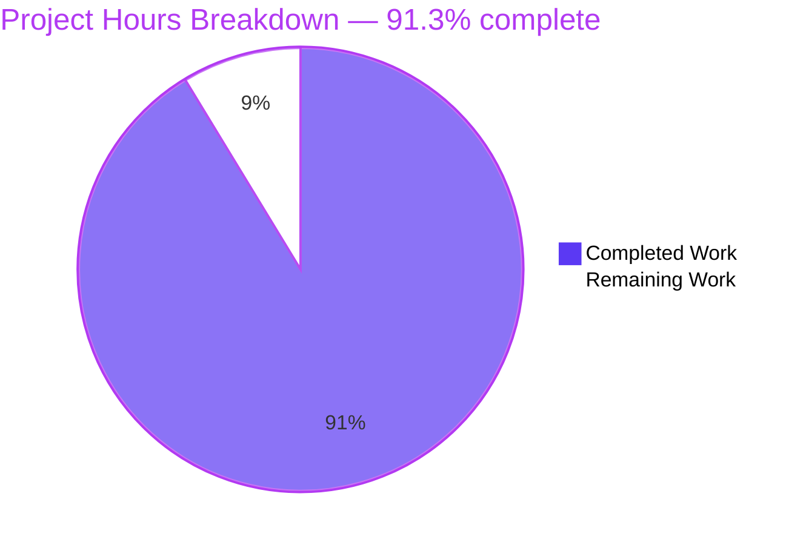
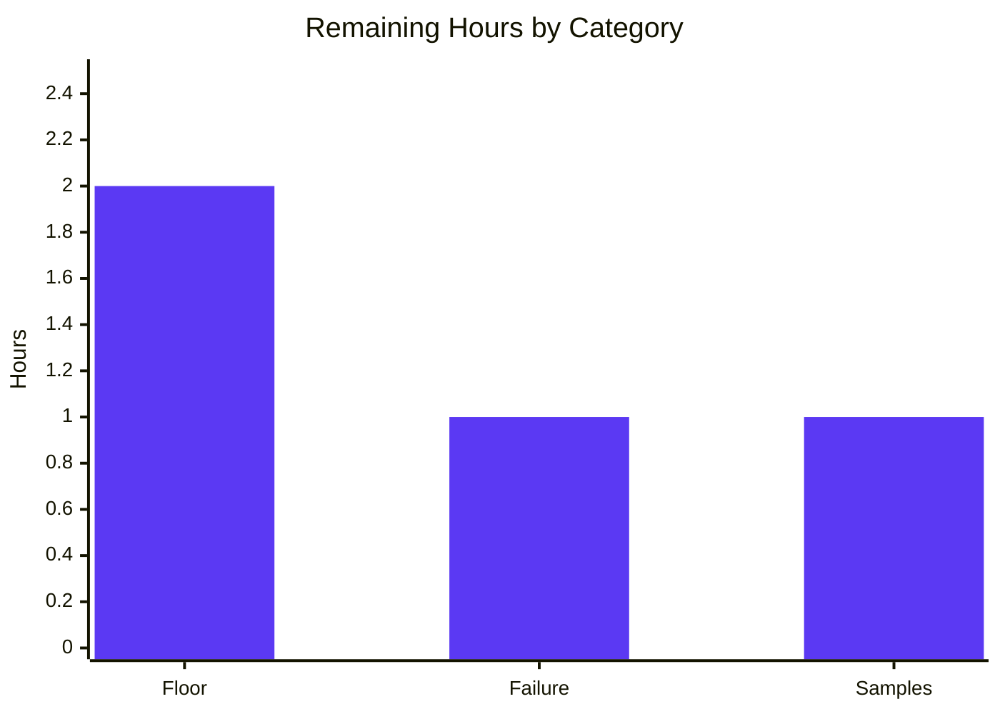

# 1. Executive Summary

## 1.1 Project Overview

The product, its users and its boundaries:

| Dimension | What it is |
| --- | --- |
| Deliverable | `server.js` (the whole application), `package.json` (identity, start script, runtime floor), `README.md` (ten-section guide) |
| Primary users | Beginner Node.js developers learning the `http` module; instructors reproducing the example |
| Business value | One readable file that demonstrates server creation, per-request routing, response writing, request logging, configuration validation and clean shutdown |
| Technical scope | One process, one listening socket, one route table with a single entry, two fixed response contracts, three console line kinds, one environment variable |
| Explicitly not included | Frameworks, routing/middleware libraries, persistence, authentication, TLS, static assets, tests, CI, containers, deployment automation |

## 1.2 Completion Status



| Metric | Hours |
| --- | --- |
| Total Hours | 46 |
| Completed Hours (AI + Manual) | 42 |
| Remaining Hours | 4 |

Completion is hours-based and scoped to the agreed work: **42 ÷ (42 + 4) × 100 = 91.3%**. The build is functionally complete and every agreed acceptance check has been exercised against a running instance; the 4 remaining hours are two verifications that have not been taken and a refresh of the document's quoted measurement samples.

## 1.3 Key Accomplishments

- `GET /hello` answers `200`, `text/plain`, `Content-Length: 11`, body `Hello world`.
- Every other method-and-path pair answers `404` with `Not Found`; `POST /hello` and `HEAD /hello` are misses, not matches.
- One `<ISO-8601 Z> <METHOD> <path>` line per request, emitted before routing decides anything.
- `PORT` read once: default `3000`, empty treated as unset, `1024`–`65535` accepted, nine invalid shapes refused with actionable text and exit 1.
- A port already in use is reported with the exact remedy and exit 1, leaving the incumbent instance serving.
- `CTRL+C` prints `Server shutting down`, releases connections and exits 0, even with an idle keep-alive connection held.
- Zero third-party dependencies: one built-in require; `npm start` runs on a host where nothing was ever installed.
- No dynamic evaluation, file-system access, outbound request or persistence — and every acceptance check is documented in the README with the result it produces.

## 1.4 Critical Unresolved Issues

**3 of the 15 agreed gates carry a residual** — all three are verification or measurement, and none blocks release.

| Issue | Impact | Owner | ETA |
| --- | --- | --- | --- |
| The reader gate: the declared runtime floor (`engines.node: ">=18.0.0"`) has never been executed — every run was on a newer line (1 of 15) | The floor rests on the API surface plus behaviour observed on a newer runtime, not on an observation of its own | Development | 2h |
| The error-handling obligation behind the configuration and bind gates: the generic `Cannot start server: <error.message>` branch has no natural trigger and has never been observed (1 of 15) | A non-`EADDRINUSE` listen failure is implemented but unproven | Development | 1h |
| The performance gates: the quoted latency and resident-set samples were measured on one host and have not been re-taken here (1 of 15) | A reader comparing their own numbers sees different figures — the document states which parts vary and why | Development | 1h |

## 1.5 Access Issues

No access issues identified. The project needs no credential, service, database, registry account or network access.

## 1.6 Recommended Next Steps

1. **[High]** Record the deployment context: the listener binds every interface, with no authentication, TLS or rate limiting by design.
2. **[Medium]** Execute the declared Node 18.0.0 floor line and re-run the acceptance checks on it.
3. **[Medium]** Exercise the generic listen-error path and record its message and exit status.
4. **[Low]** Refresh the README's quoted latency and resident-set samples on an idle host.

# 2. Project Hours Breakdown

## 2.1 Completed Work Detail

| Component | Hours | Description |
| --- | --- | --- |
| Application core | 8 | `server.js`: the frozen route table with its single `GET /hello` entry, both handlers, the single response writer that sets status, `Content-Type` and one `end()` call, request logging, and the path derivation that strips a query string and leaves percent-encoding undecoded |
| Configuration and failure paths | 5 | Port resolution and validation in `resolvePortFromEnv`: default `3000`, empty/whitespace treated as unset, trimming, the `1024`–`65535` range, the four anchored refusal messages, the startup error listener, and exit status 1 on every fatal path |
| Process lifecycle | 3 | The `SIGINT` handler: the `Server shutting down` line, `server.close()`, the tracked-socket teardown that makes the exit deterministic at the declared runtime floor, and exit status 0 |
| Package manifest | 1 | `package.json` with exactly the seven agreed fields at their agreed values, the `npm start` wiring and the advisory `engines.node` floor; no dependency section |
| Documentation | 10 | `README.md`'s ten sections in reading order — purpose, prerequisites, installation, running, configuration, testing, expected output, request logging, stopping, project structure and verification evidence — every command complete with the output it produces and an attribution clause naming what varies, including the syntax, placeholder, zero-dependency and boundary checks that reproduce the acceptance evidence |
| Acceptance verification on the running application | 12 | The full gate set exercised against live instances: both response contracts, method and path matrices, query-string and percent-encoding behaviour, request-log shape and order, the port gate including both accepted bounds and nine refused shapes, duplicate bind, shutdown status, `npm start`, manifest reads, the static and boundary greps, the latency series, the 50-way concurrency burst, the memory samples, hostile-payload and raw-socket probes, and the browser-rendered checks of both bodies |
| Integration and whole-package re-verification | 3 | Build check, seams checks across the three deliverables, integration smoke tests through the running application, and the regression sweep re-run after the documentation additions |
| **Total** | **42** | Equals the Completed Hours in Section 1.2 |

## 2.2 Remaining Work Detail

| Category | Hours | Priority |
| --- | --- | --- |
| Runtime floor verification — execute the declared Node 18.0.0 line and re-run the acceptance gate set on it, recording the startup line, both contracts, the port-gate messages and the shutdown status | 2.0 | Medium |
| Failure-path verification — induce a listen error other than a port already in use and record the message and exit status of the generic `Cannot start server: <error.message>` branch | 1.0 | Medium |
| Measurement refresh — re-take the README's quoted latency and resident-set samples on an idle host and update the figures if they differ materially | 1.0 | Low |
| **Total** | **4.0** | Equals the Remaining Hours in Section 1.2 and the `Remaining Work` value in Section 7 |

# 3. Test Results

The project ships no automated test suite: the agreed deliverable is exactly three files and the acceptance evidence is a command set, which is what was executed here against live instances of the finished server on Node v22.23.3. **85 checks executed — 81 command checks and 4 browser assertions — 85 passed, 0 failed.** Coverage is not instrumented anywhere, because no coverage tooling exists in the project.

| Area / Category | Framework | Tests | Passed | Failed | Coverage | What This Proves |
| --- | --- | --- | --- | --- | --- | --- |
| Static integrity and closed boundaries | Command checks (`node --check`, `node -e`, `npm ls`, `grep`) | 19 | 19 | 0 | Not instrumented | The file parses and the manifest parses; exactly one built-in require and no declared dependency; the tracked set is the three deliverables; no evaluation, file-system, outbound-network or export capability; the placeholder sweep's only match is the line that documents it, inside the README's verification section |
| HTTP response contracts and routing | Command checks (`curl`) | 13 | 13 | 0 | Not instrumented | `GET /hello` answers 200 with `text/plain`, `Content-Length: 11` and the byte-counted body `Hello world`; `/invalid`, a percent-encoded path, a case variant and a trailing slash answer 404 with `Content-Length: 9` and `Not Found`; six other methods on `/hello` are misses; `/hello?x=1` still matches; neither response is chunk-framed |
| Request logging | Command checks (`curl`, log inspection) | 4 | 4 | 0 | Not instrumented | Every request the runtime accepts — matched by the route table or not — produces exactly one `<ISO-8601 Z> <METHOD> <path>` line in arrival order; the query string never reaches the log and stderr stays empty |
| Port configuration and validation | Command checks (`node`, `curl`) | 34 | 34 | 0 | Not instrumented | Default `3000`; empty and whitespace-only treated as unset; surrounding whitespace trimmed; an override serving on its own port with the default left unbound; `1024` and `65535` accepted and serving; nine invalid or privileged shapes each refused with the anchored message, empty stdout, exit 1 and nothing bound; the duplicate bind reported with the exact remedy while the incumbent keeps serving; `npm start` equivalent to `node server.js` with nothing installed |
| Bind failure and lifecycle | Command checks (`node`, `kill -INT`, `curl`) | 3 | 3 | 0 | Not instrumented | The startup line appears only after a successful bind with stderr empty; `CTRL+C` prints `Server shutting down`, exits 0, releases the port, and still exits 0 after a load run |
| Performance and memory obligations | Command checks (`curl`, `seq`/`xargs`, `ps`) | 8 | 8 | 0 | Not instrumented | 20 latency samples in six-decimal seconds, worst 0.000814 s, all below the 0.010 s bound; a 50-way concurrent burst returns 550 bytes of bodies with a still-answering server; one conforming log line per request for all 1 622 requests of the performance session; resident set 56 672 → 57 960 → 58 768 → 58 020 kB across 1 500 requests, a working level rather than growth with request count |
| Browser-rendered surface | Chrome session | 4 | 4 | 0 | Not instrumented | Both contracts render as plain text in a real browser with the contracted statuses and header sets and matching `Content-Length` values, no `Transfer-Encoding`, and no application console error |
| **Total** | — | **85** | **85** | **0** | — | — |

**Not Covered** — what no test or runtime check exercises:

- **Automated regression detection.** Nothing in the repository re-runs any of the above; a future edit to `server.js` is covered only by re-running the documented commands by hand.
- **The declared runtime floor.** Every run was on Node v22.23.3. The file uses no API newer than 18.0.0 — including the deliberate avoidance of the post-18 connection helpers in the shutdown path — but the 18.0.0 line itself was never executed, so the floor is inferred from the API surface rather than observed.
- **The generic listen-error path.** Only the port-already-in-use case has a natural trigger; the `Cannot start server: <error.message>` branch needs an induced condition and has never been observed on its own.
- **Requests the runtime refuses before the handler.** A malformed request line, an unknown method token, an oversized target or an oversized header block is answered `400` or `431` by the HTTP parser and leaves no line in the request log, so "one line per incoming request" holds only for requests the runtime accepts.
- **Signal windows outside the documented flow.** A `SIGINT` delivered in roughly the first 20 ms after spawn runs before any handler can exist, and `SIGTERM` is deliberately unhandled (exit 143).
- **Protocol edges and sustained load.** HTTP/1.0 framing, `HEAD` without `Content-Length`, half-open connections held to the runtime's header timeout and IPv6 loopback were observed ad hoc, but no repeatable check asserts them; the concurrency, latency and memory figures are bounded probes, not a soak test.

# 4. Runtime Validation & UI Verification

The server was started as a real process and driven over real TCP sockets with `curl`, raw sockets and a headless Chrome session. Its only user-facing surfaces are two `text/plain` bodies and three console line kinds; there is no HTML, no client-side code and no external service to integrate with.

- ✅ **Start-up** — `node server.js` and `npm start` each print `Server listening on port <port>` from the listen callback with zero bytes on stderr, and only after the socket is bound.
- ✅ **`GET /hello`** — HTTP/1.1 200 OK, `Content-Type: text/plain`, `Content-Length: 11`, body `Hello world`, no `Transfer-Encoding`, over both `curl` and a browser navigation.
- ✅ **Catch-all route** — 404 `Not Found` with `Content-Length: 9` for an unmatched path, an unmatched method (`POST /hello`, `HEAD /hello`), a case variant, a trailing slash and a browser's `/favicon.ico` probe; `/hello?x=1` still matches `/hello`.
- ✅ **Request logging** — one conforming `<ISO-8601 Z> <METHOD> <path>` line per accepted request, in arrival order, before the routing decision, with nothing written to stderr and no query string ever logged.
- ✅ **Port configuration** — default `3000`, empty and whitespace-only treated as unset, surrounding whitespace trimmed, an override serving on its own port with the default left unbound, both accepted bounds (`1024`, `65535`) serving, and nine refused shapes each exiting 1 with the anchored message and nothing bound.
- ✅ **Bind failure** — a second instance on a held port reports the exact remedy text and exits 1 while the first instance keeps answering.
- ✅ **Shutdown** — `CTRL+C`/`kill -INT` prints `Server shutting down`, releases the connections it holds, exits 0 and leaves the port free, including with an idle keep-alive connection held open and after 1 600 requests of load.
- ✅ **Performance and memory** — 20 latency samples all under 10 ms (worst 0.000814 s), a 50-way concurrent burst answered in full with a responsive follow-up, and a resident set that climbs to a working level and holds rather than rising with request count.
- ✅ **Browser surface** — both bodies render correctly as plain text, the wire carries the contracted statuses and header sets with no chunked framing, and the only console entry is Chrome's own report of the three non-2xx statuses, not an application error.
- ⚠ **Never exercised at runtime** — the declared Node 18.0.0 floor line itself (all runs were on Node v22.23.3), and the generic `Cannot start server: <error.message>` listen-error branch, which has no natural trigger from the application's own surface.

No integration was left undriven: the product has no outbound client, no database, no queue and no third-party service, so the runtime surface is the two routes, the three console lines and the process lifecycle, all of which were exercised.

# 5. Compliance & Quality Review

## 5.1 Compliance Matrix

| Deliverable / Requirement Area | Benchmark | Verified Status | Progress |
| --- | --- | --- | --- |
| Both response contracts — `GET /hello` 200 `Hello world`; every other method-and-path pair 404 `Not Found` | Contract fidelity; exact-match routing with an explicit fallback | Verified against live instances and a browser: status, `Content-Type`, `Content-Length` and body byte-exact, with the method part of the match | ✅ Complete |
| Request observability — one log line per request before routing, plus the startup and shutdown lines | Fixed output shapes; diagnostics on stderr only | Verified: 100% of logged requests conformed to `<ISO-8601 Z> <METHOD> <path>` in arrival order, the query string never logged, stderr empty on every successful run | ✅ Complete |
| Configuration surface — `PORT` read once, default `3000`, empty treated as unset, trimming, `1024`–`65535` | Documented behaviour matchable by a reader | Verified for the default, the empty and whitespace-only fallback, trimming, an override, both bounds and nine refused shapes | ✅ Complete |
| Failure handling — actionable message, nothing bound, exit 1 for invalid configuration and for a port in use | Actionable errors; graceful failure; no raw runtime dump | Verified: anchored stderr text, empty stdout, exit 1, incumbent instance unaffected | ✅ Complete |
| Lifecycle — `CTRL+C` logs, releases connections and exits 0 | Deterministic clean shutdown at the declared runtime floor | Verified with an idle keep-alive connection held open and after 1 600 requests of load; exit status 0 and the port released | ✅ Complete |
| Manifest — seven agreed fields, exact values, no dependency section | Metadata fidelity; package-manager semantics | Verified by reading the key list and each value; `npm ls --all` reports an empty tree | ✅ Complete |
| Zero dependencies — one built-in require, nothing to install | Minimalism mandate; checkable by inspection | Verified: `require('node:http')` is the only one, and the server runs on a host where nothing was ever installed | ✅ Complete |
| Security boundaries — no evaluation, file-system access, outbound request or persistence; no internal detail in responses | Structural rather than defensive controls | Verified by inspection, by greps, by hostile-payload, raw-socket and large-body probes, and by reading both response bodies | ✅ Complete |
| Performance obligations — sub-10 ms `/hello`, unblocked concurrency, stable memory | Measured obligations, not assertions | Verified: worst latency 0.000814 s, 50/50 concurrent bodies with a 200 follow-up, resident set at a working level across 1 500 requests | ✅ Complete |
| Code quality — purpose-revealing names, one responsibility per function, reasoning-only comments, no dead code | Readability as the product's purpose | Verified: eight single-purpose functions, three constants and a frozen route table, five comment blocks each carrying a decision the code cannot, no unused declaration | ✅ Complete |
| Documentation — ten sections, every command complete with the result it produces, quoted messages matching the code | Zero-knowledge readability | Verified section by section, including the syntax, placeholder, zero-dependency and boundary checks that reproduce the acceptance evidence; one quoted block is the agreed log-format example and is labelled as such | ✅ Complete, with a 1h sample refresh |
| Completeness — exactly the three agreed files, no placeholder, unreachable branch or unnamed artefact | Exhaustive deliverable set; no provisional content | Verified: the deliverable set holds exactly three tracked paths at the repository root and no path beyond them; the placeholder sweep's only match is the line documenting it; no test, CI, container or lockfile artefact | ✅ Complete |

## 5.2 AAP & Rule Divergences and Gaps

| # | What the AAP/Rule Required | What Was Delivered Instead | Why It Diverged | Impact | Remediation |
| --- | --- | --- | --- | --- | --- |
| 1 | The production-readiness sweep across the three files "produces no output" | The sweep is documented inside `README.md` section 10, so it matches its own documenting line: exactly one match, `README.md:544`, with `server.js` and `package.json` matching nothing and no second README line matching | The reader explicitly asked for the acceptance evidence to be documented in the README; documenting the check necessarily writes its pattern into the file it scans, so the two could not both hold literally and the reader's instruction won | None for the product: both code files are still proven free of provisional content | None. Keep the single self-match; a match in a code file, or a second `README.md` match, remains a genuine defect |
| 2 | The agreed concurrency check counted anchored whole lines, `… \| grep -c '^Hello world$'`, expected to print `50` | `README.md` documents `… \| grep -o 'Hello world' \| wc -l`, and concurrency was verified by total byte count (550) and body count | The contracted body has no trailing newline, so fifty concurrent bodies concatenate into one line and an anchored whole-line count can never print `50` for any correct implementation | None for the product; a reader re-running the agreed text would see `0` and conclude the server was broken | None required. Align any internal acceptance checklist with the documented form when convenient |
| 3 | `README.md` listed as a file to create, alongside `server.js` and `package.json` | Delivered as an in-place update over the repository's pre-existing two-line scaffold (`M README.md`, +478/−2 at the time) | The repository already carried a scaffold at that path from its initial commit, so its content was replaced rather than a new path created | None: the delivered document is complete and no section references the scaffold | None. A diff against the initial commit will show the two deleted scaffold lines |
| 4 | Four ordered shutdown steps, read as a sequence: log, `server.close(callback)`, release tracked sockets, exit 0 from the callback | `server.js:106-116` destroys the tracked sockets immediately after calling `server.close(callback)`, before that callback runs | Releasing the sockets only from the callback could never release an idle keep-alive connection, so `CTRL+C` could hang instead of exiting 0 — the exit-status requirement outranks the step ordering | Connections close abruptly at shutdown instead of being drained; the exit is deterministic (status 0 in single-digit milliseconds, even with an idle connection held) | None. If connection draining is ever promised, the shutdown path and the README must change together |
| 5 | The accepted port range and privileged-port refusal documented, with the gate reading "refuses to bind to privileged ports without explicit configuration" | Every value below 1024 is refused unconditionally; no override flag, second environment variable or configuration file exists | The request names no flag, second variable or configuration file, so providing an explicit-configuration path would invent an interface nothing asks for | A reader cannot bind a privileged port at all — the refusal is documented as behaviour in the Configuration section rather than an option to switch off | None |
| 6 | `engines.node: ">=18.0.0"`, and the reader gate expects that floor to run the file | The floor is declared and the source stays inside 18.0.0 API surface, but every run was on Node v22.23.3 | The build environment admits no Node below its supported lines, and that restriction outranks the declared floor | The floor's support claim rests on API inspection plus behaviour on a newer line, not on an executed run | Run the file once on the oldest line you intend to advertise (2h, Section 2.2) |

**Divergence 1 — the document now carries the sweep it describes.** The agreed contract fixed the production-readiness sweep as a three-file search whose result is nothing, and separately asked the README to reproduce the acceptance evidence. Writing that command into the README puts its own pattern into a file the command scans, so a literal "no output" and a documented check cannot coexist. The reader's instruction to document the evidence was taken as the higher source. The shipped shape is exactly one match — the documenting line at `README.md:544`, which the prose beside it explains and whose line number it presents as a stand-in — with `server.js` and `package.json` matching nothing. The consequence for you is a single line to expect: seeing it is correct, and seeing a second one, or any match in a code file, would indicate real provisional content. No action is required.

**Divergence 2 — the concurrency counter.** Counting anchored whole lines cannot work here: the body is exactly `Hello world` with `Content-Length: 11` fixed, so there is no trailing newline, and fifty concurrent bodies arrive concatenated on one line, making `grep -c '^Hello world$'` print `0` however healthy the server is. Rather than publish a command that cannot succeed, the README documents the faithful equivalent `grep -o 'Hello world' | wc -l`, which prints `50`, and the underlying property was measured three ways: fifty concurrent requests, none refused, 550 bytes of bodies, and a 200 follow-up. What remains for you is bookkeeping only — if an internal checklist still quotes the anchored form, update it so nobody reads a correct server as broken.

**Divergence 3 — the README was updated, not created.** The agreed file plan describes all three deliverables as new files, which was true of `server.js` and `package.json`. The repository already carried a two-line placeholder at `README.md` from its initial commit, so the delivered document replaced that content in place. Reviewing the branch you will see the file recorded as modified rather than added, and a diff against the first commit will include the two deleted scaffold lines. Nothing in the document depends on the scaffold, no section refers to it, and no reader-visible behaviour follows from the change — it is recorded so the history reads correctly when you compare the branch against its base.

**Divergence 4 — the shutdown step order.** The agreed shutdown description lists four steps as a sequence, with the tracked sockets released from the `server.close()` callback. `server.js:106-116` performs that release immediately after calling `close()`, because `close()` completes only once every existing connection has ended: releasing the sockets from the callback would let an idle keep-alive connection hold the process open indefinitely, so `CTRL+C` could hang instead of exiting `0`. The ordering that ships is what makes the exit deterministic at the declared runtime floor, where the runtime's own helpers for closing idle connections do not exist. The trade-off is that connections close abruptly at shutdown rather than being drained; if draining is ever promised, the shutdown path and the README must change together.

**Divergence 5 — the privileged-port refusal has no override.** The agreed configuration gate reads "refuses to bind to privileged ports without explicit configuration", which presumes an explicit-configuration path exists. The request itself names no flag, no second environment variable and no configuration file, so none was invented: `resolvePortFromEnv` rejects every value below 1024 unconditionally, each with a message that states the reason and the accepted range, and `README.md`'s Configuration section documents that refusal as behaviour a reader can rely on rather than an option they can switch off. Nothing follows for you beyond knowing that port 80 cannot be bound by any supported route, which is the documented contract.

**Divergence 6 — the declared floor has never been executed.** The agreed manifest fixes `engines.node: ">=18.0.0"` and expects the floor to run the file. It does not run in this build environment, which admits no Node below its supported lines, and that restriction outranks the declared floor, so every verification run was on Node v22.23.3. The source is deliberately confined to 18.0.0 API surface — one built-in require, and a shutdown path that releases its own sockets instead of calling the post-18 connection helpers — so the claim is well-founded but unproven by execution. Running the file once on the oldest line you intend to advertise closes it (2h, Section 2.2).

No user-specified rules accompany this project, so nothing in the delivery departs from a user rule. The six divergences above are departures from the agreed plan or from the environment it assumed, not from user instructions.

# 6. Risk Assessment

Risks below are forward-looking: what could still go wrong once this code is used or extended. Every one is a property of the agreed scope, of the runtime the application sits on, or of a verification not yet taken — not an open defect.

| Risk | Category | Severity | Probability | Mitigation | Status |
| --- | --- | --- | --- | --- | --- |
| No automated regression detection: the deliverable is three files with no suite, so an edit to `server.js` is checked only by re-running the documented commands by hand | Technical | Medium | High | Use the documented acceptance commands as a change checklist; keep the two contracts, the log shape and the port-gate messages as the pass criteria | Accepted, inherent to the agreed scope |
| The declared runtime floor (`engines.node: ">=18.0.0"`) is past end-of-life, and that line has never been executed here | Operational | Medium | High | Run the file once on the oldest line you intend to support before advertising it; raise the declared floor when the tutorial is next revised | Open — 2h verification task in Section 2.2 |
| No authentication, TLS, rate limiting or security headers, and the listener binds every interface | Security | Medium | Medium | Run it for its intended teaching purpose on a local or trusted network, or place it behind infrastructure that supplies those layers | Accepted by design; a deployment decision, not a code gap |
| Working-set growth under large request bodies: repeated multi-megabyte uploads that are never read push resident memory from roughly 60 MB to roughly 80 MB, and the runtime does not return those pages to the OS | Technical | Low | Medium | Bounded and self-limiting (flat across consecutive large requests); if uploads are expected, terminate them at a proxy rather than adding body handling the contract forbids | Accepted; measured and bounded |
| The request log is not a complete access record: requests the runtime refuses before the handler (malformed request lines, unknown method tokens, oversized targets or headers) produce no application log line | Operational | Low | Medium | Know the boundary when reading the log or writing a client; only requests the runtime accepts appear in it | Accepted; runtime-provided HTTP framing |
| Console output integrity: the log carries the full path, so a client can drive up to about 16 KB of stdout per request, and an operator-supplied `PORT` value is echoed to stderr verbatim | Operational | Low | Medium | Treat stdout and stderr as untrusted text in any downstream parsing; the parser's header limit bounds the per-line cost | Accepted; format is contracted |
| Unbounded connection tracking: the tracked socket set grows with concurrently open connections, with no connection or timeout limits configured | Technical | Low | Low | Sound at the declared scale (single host, tens of connections); the runtime's own idle timeout and the host's descriptor limit are the practical bounds | Accepted; scale is out of the agreed scope |
| The documented literal ports (`3000`, `4000`) may be occupied on a reader's machine, so a walkthrough shows the bind-failure message instead of the quoted startup line | Integration | Low | Medium | The documented remedy is the `PORT` override, and the README names the port as the part that varies between hosts | Accepted; documented, with the remedy quoted |

# 7. Visual Project Status

Project hours, split between the work that is complete and the work that remains:


Remaining hours by category, as listed in Section 2.2:



| Remaining Category (Section 2.2) | Hours | Priority |
| --- | --- | --- |
| Runtime floor verification | 2.0 | Medium |
| Failure-path verification | 1.0 | Medium |
| Measurement refresh | 1.0 | Low |
| **Total Remaining** | **4.0** | — |

**Completed Work = 42 hours** and **Remaining Work = 4 hours**, matching the metrics table in Section 1.2 and the totals in Sections 2.1 and 2.2. The completion figure these charts display is **91.3%** — 42 ÷ 46 × 100.

# 8. Summary & Recommendations

**What was delivered and verified.** A complete, runnable teaching server in three files: `server.js` with the frozen route table, both handlers, a single response writer, request logging, port resolution and validation, the two fatal failure paths and a deterministic `CTRL+C` shutdown; `package.json` with exactly the seven agreed fields and no dependency section; and a ten-section `README.md` whose every command is paired with the output it produces, its acceptance evidence included. Everything the project promises was exercised on live instances: both contracts byte-exact over `curl` and in a browser, log lines conforming one per request in arrival order, the default and empty-valued port behaviour, both accepted bounds, nine refused shapes, the port-in-use report, the clean exit status, sub-10 ms latency, a fifty-way concurrent burst, a resident set that settles at a working level, and the static, dependency and boundary checks that prove the file evaluates nothing, touches no file system, makes no outbound request and stores nothing. **85 checks executed, none failed.**

**Where the project stands.** The agreed work is **91.3% complete** — 42 of 46 hours delivered, 4 remaining. Every scoped requirement is met as written: two carry verification that has not yet been taken and one carries a measurement refresh, and the twelve compliance areas in Section 5.1 pass. The remaining hours are not missing functionality: 3 of the 4 are verification (executing the declared Node 18.0.0 floor line, and exercising the generic listen-error branch, which has no natural trigger) and 1 is refreshing the document's quoted latency and resident-set samples on an idle host. Nothing on the list changes behaviour; all of it changes what a reader or reviewer can see for themselves.

**The critical path to production.** The code is ready to run as it stands — start it with `node server.js` or `npm start` on any Node 18-or-newer host and both contracts answer immediately, with nothing to install and nothing to configure beyond `PORT`. Before publishing or teaching from it, close the remaining items in this order: confirm that the floor line you intend to advertise actually runs the file (2h), exercise the generic listen-error branch (1h), and refresh the quoted samples on an idle host (1h). None of these blocks a reader from using the server today.

**Accepted by design, and worth deciding deliberately.** Five properties are absences the agreed scope specifies rather than gaps: no automated test suite (so a future edit is covered only by re-running the documented commands), no authentication, TLS, rate limiting or security headers (with the listener bound to every interface), no persistence or static files, no CI, container or deployment automation, and no connection or timeout tuning. Each was verified as a deliberate condition of the three-file deliverable. If this tutorial is ever placed somewhere other than a local or trusted network, the security set is the first thing to add — and the first four are exactly the layers a real service would need around it.

**Success metrics.** Both response contracts answer byte-exactly with determinate framing (no chunked encoding) over `curl` and in a browser; one conforming log line per accepted request with an empty stderr; the port gate accepts 1024–65535, defaults to 3000 for an unset or empty value, and refuses nine invalid shapes with actionable text and exit 1; a port already in use is reported without disturbing the incumbent; `CTRL+C` exits 0 with the port released; latency stays under 10 ms and memory levels off after warm-up; the repository holds exactly the three agreed files with zero third-party dependencies; and each acceptance check is documented with the result it produces. Every one of those metrics was observed on this build, and the commands that reproduce them are in Section 9.

# 9. Development Guide

## 9.1 System Prerequisites

| Requirement | Detail |
| --- | --- |
| Node.js | 18.0.0 or newer (`engines.node: ">=18.0.0"`). Verified on v22.23.3. The file uses no API newer than 18.0.0, so it runs unchanged on 18.x, 20.x, 22.x and later lines |
| npm | Optional. Needed only for `npm start`; the server runs from the Node binary alone. Verified on npm 11.21.0 |
| curl | Optional. Used by the verification commands below; any HTTP client works |
| Everything else | None. No database, broker, cache, container runtime, compiler, bundler or linter is involved, and no service has to be running before the server starts |

```bash
node --version    # expect v18.0.0 or newer; this build prints v22.23.3
npm --version     # only if you plan to use npm start
```

## 9.2 Environment Setup

```bash
cd /path/to/your/checkout     # the repository root is the working directory every command assumes
ls                            # expect README.md, package.json and server.js
```

A `blitzy/` directory may also be present in the checkout: it holds generated project documentation and is not part of the deliverable, so nothing in this guide reads or writes it.

There is no virtual environment, no `.env` file, no secret and no configuration file. The single configuration input is the `PORT` environment variable, read once at startup. It can be set inline, exported, or left unset:

```bash
PORT=4000 node server.js        # inline, for this process only
export PORT=4000                # for the rest of the shell session
unset PORT                      # back to the 3000 default
```

## 9.3 Dependency Installation

There is nothing to install, and you should **not** run `npm install`. The project declares no dependency of any kind, so nothing is resolved and no `node_modules` directory is needed; running it anyway writes an untracked `package-lock.json` into your checkout. Confirm the empty inventory at any time:

```bash
npm ls --all
```

```text
nodejs-tutorial-hello-world@1.0.0 /path/to/your/checkout
└── (empty)

```

```bash
node -e "const p=require('./package.json');console.log(Object.keys(p).join(','))"
node -e "const p=require('./package.json');console.log(Object.keys(p.dependencies||{}).length,Object.keys(p.devDependencies||{}).length)"
grep -n "require(" server.js
```

```text
name,version,description,main,scripts,engines,keywords
0 0
10:const http = require('node:http');
```

## 9.4 Application Startup

Run it directly, or through the package script — the two are equivalent, because `scripts.start` is `node server.js`:

```bash
node server.js
```

```text
Server listening on port 3000
```

```bash
npm start
```

```text

> nodejs-tutorial-hello-world@1.0.0 start
> node server.js

Server listening on port 3000
```

The startup line is printed from the listen callback, so seeing it means the socket is bound; stderr stays empty on a successful start. The process stays in the foreground and logs each request as it arrives. Stop it with `CTRL+C`, which prints `Server shutting down` and exits with status 0.

To run it in the background while you work, write the log outside the checkout so the repository keeps its three files, capture the pid, and stop it by that pid:

```bash
node server.js > "$HOME/server.log" 2>&1 &
SRV=$!
sleep 1
cat "$HOME/server.log"       # Server listening on port 3000
kill -INT "$SRV"             # same signal as CTRL+C; the shutdown line is appended to the log
wait "$SRV"; echo "exit=$?"  # exit=0
```

## 9.5 Verification Steps

**Both response contracts.** With the server running:

```bash
curl -i http://localhost:3000/hello
```

```text
HTTP/1.1 200 OK
Content-Type: text/plain
Content-Length: 11

Hello world
```

```bash
curl -i http://localhost:3000/invalid
```

```text
HTTP/1.1 404 Not Found
Content-Type: text/plain
Content-Length: 9

Not Found
```

A live `curl -i` also prints the runtime's own `Date`, `Connection` and `Keep-Alive` headers around those lines; the application sets only `Content-Type` and the status code, and the runtime computes `Content-Length`. Note that `curl` also prints its own progress meter whenever it writes the body somewhere other than your terminal (a pipe, a file or `/dev/null`); the meter comes from `curl`, not from the server, and `-s` removes it along with curl's error text. Check that the method is part of the match, the query string is stripped and percent-encoding is left undecoded:

```bash
curl -i -X POST http://localhost:3000/hello   # 404 Not Found
curl -i http://localhost:3000/hello?x=1       # 200 Hello world
curl -i http://localhost:3000/%68ello         # 404 Not Found
```

**Request logging.** Read the terminal (or the log file) after the requests above. Each accepted request produced exactly one line, in arrival order, in this shape — and the logged path never carries a query string:

```text
2026-10-17T07:23:54.401Z GET /hello
2026-10-17T07:23:54.409Z GET /invalid
2026-10-17T07:23:54.414Z POST /hello
2026-10-17T07:23:54.420Z GET /hello
```

**The port gate.** The default, the empty-value fallback and the accepted range:

```bash
PORT=4000 node server.js                 # Server listening on port 4000
PORT= node server.js                     # Server listening on port 3000 (empty is treated as unset, never port 0)
PORT=" 4000 " node server.js             # trims the surrounding whitespace and binds 4000
PORT=1024 node server.js                 # binds the lowest accepted port
PORT=65535 node server.js                # binds the highest accepted port
```

Every other shape is refused before `listen()` is ever called, with the offending value quoted back and exit status 1:

```bash
for v in abc 3.5 1e3 0 80 65536 1023; do PORT="$v" node server.js; echo "exit=$?"; done
```

```text
Invalid PORT value "abc": PORT must be a whole number between 1024 and 65535.
exit=1
Invalid PORT value "3.5": PORT must be a whole number between 1024 and 65535.
exit=1
Invalid PORT value "1e3": PORT must be a whole number between 1024 and 65535.
exit=1
Invalid PORT value "0": port 0 would let the operating system choose a port; choose a port between 1024 and 65535.
exit=1
Invalid PORT value "80": ports below 1024 are privileged and cannot be bound; choose a port between 1024 and 65535.
exit=1
Invalid PORT value "65536": PORT must be between 1024 and 65535.
exit=1
Invalid PORT value "1023": ports below 1024 are privileged and cannot be bound; choose a port between 1024 and 65535.
exit=1
```

Ports below 1024 are always refused — there is no override flag, second variable or configuration file that can allow them.

**A port already in use.** Start a second instance while the first one holds its port:

```bash
PORT=3000 node server.js
```

```text
Cannot start server: port 3000 is already in use. Stop the process using it, or start it with a different PORT between 1024 and 65535.
```

The second instance writes that line to stderr, binds nothing and exits 1; the instance that already held the port keeps serving.

**The shutdown status.** From a script:

```bash
node server.js & SRV=$!; sleep 1; kill -INT $SRV; wait $SRV; echo "exit=$?"
```

```text
Server listening on port 3000
Server shutting down
exit=0
```

Handling the signal is deliberate: without the explicit handler, Node.js would terminate with status 130 instead.

**Performance spot-checks.** `curl` reports seconds, so every value below `0.010` passes:

```bash
for i in $(seq 1 20); do curl -s -o /dev/null -w '%{time_total}\n' http://localhost:3000/hello; done
```

```text
0.000601
0.000593
0.000470
...
0.000258
```

The worst value of that run was 0.000775 s, and the samples settle once the connection is warm. Fifty concurrent requests each return the body, and the server answers a follow-up request immediately. Count the bodies rather than the lines — they arrive without a trailing newline:

```bash
seq 1 50 | xargs -P 50 -I{} curl -s http://localhost:3000/hello | grep -o 'Hello world' | wc -l   # 50
curl -s -o /dev/null -w '%{http_code}\n' http://localhost:3000/hello                              # 200
```

Memory stays level rather than growing with request count:

```bash
node server.js & SRV=$!; sleep 1
BEFORE=$(ps -o rss= -p $SRV); for i in $(seq 1 500); do curl -s -o /dev/null http://localhost:3000/hello; done
MID=$(ps -o rss= -p $SRV); for i in $(seq 1 500); do curl -s -o /dev/null http://localhost:3000/hello; done
THIRD=$(ps -o rss= -p $SRV); for i in $(seq 1 500); do curl -s -o /dev/null http://localhost:3000/hello; done
echo "$BEFORE $MID $THIRD $(ps -o rss= -p $SRV)"; kill -INT $SRV
```

```text
56672 57960 58768 58020
```

A bounded rise of a few percent during warm-up is normal and the values then settle; the check is that they do not rise with the request count.

**Static and boundary checks.** Each of these is a complete check in itself:

```bash
node --check server.js                                     # exit 0, nothing printed
node -e "JSON.parse(require('fs').readFileSync('package.json','utf8'))"   # silent, exit 0
grep -n "require(" server.js                               # the single built-in require
grep -nE "eval\(|new Function|require\('vm'\)" server.js    # no output, exit 1
grep -nE "require\('(node:)?fs" server.js                   # no output, exit 1
grep -nE "http\.request|https|fetch\(|net\.connect|dns" server.js   # no output, exit 1
grep -nEi "TODO|FIXME|XXX|placeholder|not implemented|coming soon" server.js package.json README.md
git ls-files
```

```text
10:const http = require('node:http');
README.md:544:grep -nEi "TODO|FIXME|XXX|placeholder|not implemented|coming soon" server.js package.json README.md
README.md
package.json
server.js
```

The sweep's single match is the documenting line itself, which is why the README quotes its result with the pattern and the line number stood in for; `server.js` and `package.json` match nothing. A second match, or any match in a code file, would mean provisional content survived.

## 9.6 Example Usage

A complete session, with the output you should see at each step:

```bash
cd /path/to/your/checkout
node --version                 # v22.23.3 (or any version from 18.0.0)
node server.js                 # Server listening on port 3000
```

In another terminal:

```bash
curl http://localhost:3000/hello               # Hello world
curl -i http://localhost:3000/invalid          # HTTP/1.1 404 Not Found ... Not Found
curl -i -X POST http://localhost:3000/hello    # HTTP/1.1 404 Not Found ... Not Found
```

The first terminal now shows one log line per request:

```text
Server listening on port 3000
2026-10-17T07:23:54.401Z GET /hello
2026-10-17T07:23:54.409Z GET /invalid
2026-10-17T07:23:54.414Z POST /hello
```

Run it on another port instead, and stop it with `CTRL+C`:

```bash
PORT=4000 node server.js       # Server listening on port 4000 (nothing answers on 3000)
```

```text
Server shutting down
```

Adding a route is one entry in the frozen `ROUTES` table plus one handler function; nothing else in the file changes.

## 9.7 Troubleshooting

| Symptom | Cause | Resolution |
| --- | --- | --- |
| `Cannot start server: port 3000 is already in use. …` | Another process holds the port | Stop that process, or start this one with `PORT=4000 node server.js` |
| `Invalid PORT value "…": …` and exit 1 | The value is not a whole decimal number in `1024`–`65535`, or it is a privileged port | Use a value in range; `PORT=` (empty) and surrounding whitespace are accepted and mean the default |
| The server prints the full `EADDRINUSE` help text after `npm start` and exits 1 | Either an existing instance is running, or a self-contained command in the README started one on the same port | Stop the running server first, or use a fresh terminal and a free `PORT` |
| `Error: Cannot find module '/path/server.js'` | The command was run from outside the repository root | `cd` to the repository root and run it again |
| `curl` prints `000` for a probe | Nothing is listening on that port (this is `%{http_code}`'s value on a connection refusal; `curl` also exits 7 and `-s` hides its message — add `-S` to see it) | Check the port the server reports in its startup line |
| `curl` prints a `% Total % Received % Xferd` progress meter | The response body went to a pipe, a file or `/dev/null` rather than your terminal | Expected: the meter is curl's own output; add `-s` to remove it |
| You see extra lines above the startup line after `npm start` | npm prints its own script banner before running `node server.js` | Expected: the blank line, `> nodejs-tutorial-hello-world@1.0.0 start` and `> node server.js` come from npm; `Server listening on port …` is the server's own line |
| A browser shows `Failed to load resource … 404` for `/favicon.ico` | Chrome probes for a favicon and the catch-all answers 404 | Expected; the application ships no assets, and the console entry is the browser's own status report |
| An untracked `package-lock.json` appears | `npm install` was run | Delete it; the project needs no install step |
| The server is unreachable from another machine | Nothing is wrong with the code, but the listener binds every interface and there is no authentication or TLS | Treat it as a local teaching server or put it behind infrastructure that supplies those layers |
| A long-lived run shows resident memory rising a few percent then flattening | The runtime warms its heap before it stabilises | Expected; re-sample after more traffic — the check is that the values do not rise with the request count |

# 10. Appendices

## Appendix A. Command Reference

| Command | Purpose | Expected result |
| --- | --- | --- |
| `node server.js` | Start the server | `Server listening on port 3000`, stderr empty |
| `npm start` | Start through the package script | npm's banner, then `Server listening on port 3000` |
| `PORT=4000 node server.js` | Start on another port | `Server listening on port 4000`; the default port stays unbound |
| `PORT= node server.js` | Empty value | `Server listening on port 3000`; port 0 is never bound |
| `curl -i http://localhost:3000/hello` | Functional contract | 200, `text/plain`, `Content-Length: 11`, `Hello world` |
| `curl -i http://localhost:3000/invalid` | Catch-all contract | 404, `text/plain`, `Content-Length: 9`, `Not Found` |
| `curl -i -X POST http://localhost:3000/hello` | Method participates in the match | 404, `Not Found` |
| `kill -INT <pid>` | Same signal as `CTRL+C` | `Server shutting down`, exit status 0 |
| `node --check server.js` | Syntax check | Exit 0, no output |
| `node -e "JSON.parse(require('fs').readFileSync('package.json','utf8'))"` | Manifest syntax check | Exit 0, no output |
| `npm ls --all` | Dependency inventory | Project line, then `(empty)` |
| `node -e "const p=require('./package.json');console.log(Object.keys(p).join(','))"` | Manifest field names | `name,version,description,main,scripts,engines,keywords` |
| `node -e "const p=require('./package.json');console.log(Object.keys(p.dependencies||{}).length,Object.keys(p.devDependencies||{}).length)"` | Declared dependency count | `0 0` |
| `grep -n "require(" server.js` | Source dependency check | `10:const http = require('node:http');` |
| `grep -nEi "eval\(\|new Function\|require\('vm'\)" server.js` | Dynamic-evaluation boundary | No output, exit 1 |
| `grep -nE "require\('(node:)?fs" server.js` | File-system boundary | No output, exit 1 |
| `grep -nE "http\.request\|https\|fetch(\|net\.connect\|dns" server.js` | Outbound-client boundary | No output, exit 1 |
| `grep -nEi "TODO\|FIXME\|XXX\|placeholder\|not implemented\|coming soon" server.js package.json README.md` | Provisional-content sweep | One match — the documenting line in `README.md` — and nothing in either code file |
| `ps -o rss= -p <pid>` | Resident set size in 1024-byte units | Samples that do not rise with request count |
| `seq 1 50 \| xargs -P 50 -I{} curl -s http://localhost:3000/hello \| grep -o 'Hello world' \| wc -l` | Concurrency check | `50` |
| `git ls-files` | Tracked deliverable set | `README.md`, `package.json`, `server.js` |

## Appendix B. Port Reference

| Port | Meaning |
| --- | --- |
| `3000` | Default when `PORT` is unset, empty or whitespace only |
| `1024`–`65535` | The accepted range; both bounds were exercised |
| `< 1024` | Privileged; always refused with the privileged-port message, exit 1 |
| `0` | Refused: the operating system would choose an arbitrary port |
| `> 65535` | Refused: outside the accepted range |
| `4000` | The port used in the README's override example |

## Appendix C. Key File Locations

| Path | Contents |
| --- | --- |
| `server.js` | The whole application: constants, response writer, request logger, both handlers, the frozen `ROUTES` table, the request pipeline, port resolution and validation, the startup error listener, the `SIGINT` shutdown path and the guarded entry call |
| `package.json` | Name, version, description, main, start script, engines floor and keywords — seven fields, no dependency section |
| `README.md` | Purpose, prerequisites, installation, running, configuration, testing, expected output, request logging, stopping, and the project structure with the acceptance and performance checks |

## Appendix D. Technology Versions

| Technology | Version used | Notes |
| --- | --- | --- |
| Node.js | v22.23.3 | Declared floor `>=18.0.0`; only API present at 18.0.0 is used, so the file runs unchanged on newer lines |
| npm | 11.21.0 | Used only for `npm start` and the dependency inventory |
| HTTP | 1.1 | Provided by `node:http`; HTTP/1.0 clients receive connection-close framing without `Content-Length` |
| Third-party packages | None | The single `require` is `node:http` |
| curl | 8.14.1 | The verification client; `-s` removes its progress meter and its error text |

## Appendix E. Environment Variable Reference

| Variable | Required | Values | Behaviour |
| --- | --- | --- | --- |
| `PORT` | No | A whole decimal number from `1024` to `65535`, optionally surrounded by whitespace | Read once at startup; unset, empty or whitespace-only resolves to `3000`; any other value writes an actionable message to stderr and exits 1 before any socket is bound. No other environment variable, secret or configuration file is read |

## Appendix F. Developer Tools Guide

| Tool | Why you need it here |
| --- | --- |
| `node` | Runs the server and the `-e` manifest reads; `node --check server.js` is the whole build surface |
| `npm` | Optional: `npm start`, and `npm ls --all` to prove the empty dependency tree |
| `curl` | Exercises both contracts and the latency, override and status-code probes |
| `seq` / `xargs` | Issues concurrent requests without adding a load-testing dependency |
| `ps` | Samples the process's resident set for the memory check |
| `grep` | Runs the boundary, dependency and provisional-content checks |
| `git` | Confirms the tracked set is exactly the three deliverables (`git ls-files`) |

## Appendix G. Glossary

| Term | Meaning |
| --- | --- |
| Route table | The frozen `ROUTES` object keyed by `"<METHOD> <path>"`; a request is matched by exact string equality against it, with an explicit fallback handler for everything else |
| Catch-all | The fallback that answers every unmatched method-and-path pair with 404 `Not Found` |
| Implicit-header response | Setting `res.statusCode` and the headers and then calling `res.end(body)` once, so the runtime computes `Content-Length` from the whole body and no chunked framing is used |
| Tracked socket | A connection the server adds to its socket set on the `connection` event and removes when it closes, so shutdown can release connections that would otherwise idle |
| `EADDRINUSE` | The error the runtime raises when a port is already bound; reported with the port and the remedy rather than as a raw dump |
| Declared floor | `engines.node: ">=18.0.0"` — advisory to npm, and the oldest line the file is written against |
| Acceptance gate | A command whose output is the pass criterion; the project's verification is this command set rather than a test suite |
